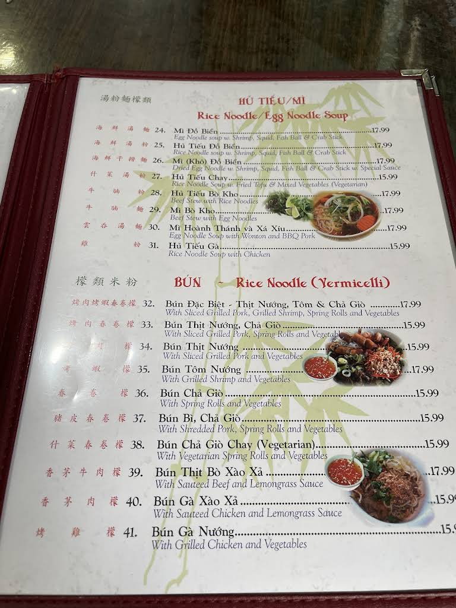
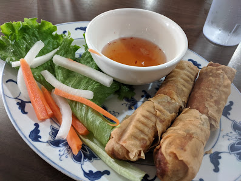
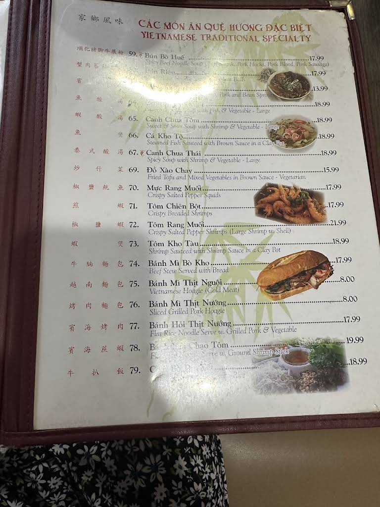

# 🍜 Phở Sydney - Vietnamese Restaurant Menu & Digital Platform

<p align="center">
  
</p>

<p align="center">
  <b>Hương vị ẩm thực Việt truyền thống đậm đà bản sắc</b><br>
  <i>Authentic Vietnamese Cuisine & Digital Menu Platform</i>
</p>

<p align="center">
  <a href="https://github.com/huynhnguyenbao3105/PhoSydney"></a>
  <a href="https://maps.app.goo.gl/9xizRKacCeMM31Ly5"></a>
  
  
  
</p>

---

## 📍 Thông tin nhà hàng (Location & Contact)

- **Tên nhà hàng:** **Phở Sydney**
- **Địa chỉ:** [2323 Atlantic Ave, Atlantic City, NJ 08401, Hoa Kỳ](https://maps.app.goo.gl/9xizRKacCeMM31Ly5)
- **Số điện thoại:** [+1 609-348-5946](tel:+16093485946)
- **Giờ mở cửa:** Tất cả các ngày trong tuần (Thứ Hai – Chủ Nhật) từ **10:00 – 21:00**
- **Đánh giá Google Maps:** ⭐ **4.1 / 5 sao** *(với hơn 800+ lượt đánh giá trên [Google Maps](https://maps.app.goo.gl/9xizRKacCeMM31Ly5))*
- **Chỉ đường trực tiếp:** [Xem vị trí trên Google Maps](https://maps.app.goo.gl/9xizRKacCeMM31Ly5)
- **Mô tả:** Quán ăn Việt Nam ấm cúng, bình dân tại Atlantic City, chuyên phục vụ các món phở, hủ tiếu, mỳ, cơm tấm, bánh mì và các món ăn truyền thống đậm đà bản sắc Việt.

---

## 📖 Giới thiệu (About the Project)

**Phở Sydney** là dự án số hóa thực đơn và xây dựng nền tảng trải nghiệm ẩm thực trực tuyến cho nhà hàng Việt Nam tọa lạc tại Atlantic City, NJ. Dự án tập trung vào việc quản lý danh mục món ăn chuẩn xác, hình ảnh minh họa chân thực và chuẩn bị nền tảng giao diện website trực quan cho thực khách.

- **Ẩm thực đa dạng:** Hơn 70+ món ăn truyền thống đặc trưng từ Phở bò, Hủ tiếu, Bún thịt nướng, Cơm tấm đến các món nhậu và giải khát.
- **Hình ảnh sắc nét:** Toàn bộ thư viện ảnh món ăn thực tế đã được chuẩn hóa định dạng PNG.
- **Hỗ trợ song ngữ:** Danh mục món ăn có song ngữ Việt - Anh giúp phục vụ tối ưu cho cả thực khách bản địa và du khách quốc tế.

---

## 📂 Cấu trúc thư mục (Repository Structure)

```text
PhoSydney/
├── img/                  # Thư viện hình ảnh món ăn đã chuẩn hóa (36 ảnh định dạng .png)
│   ├── 1.png             # Gỏi cuốn
│   ├── 2.png             # Gỏi cuốn chay
│   ├── ...
│   └── 36.png
├── Menu.md               # Chi tiết bảng thực đơn song ngữ Việt - Anh và giá bán (USD)
└── README.md             # Tài liệu tổng quan dự án
```

---

## 🍽️ Danh mục thực đơn tóm tắt (Menu Overview)

Chi tiết đầy đủ bảng giá và mô tả từng món được lưu trữ tại file **[Menu.md](Menu.md)**.

| Phân Loại | Số Lượng Món | Món Tiêu Biểu | Mức Giá Tham Khảo |
| :--- | :---: | :--- | :---: |
| **I. Món Khai Vị** *(Appetizers)* | 6 món | Gỏi cuốn, Chả giò, Súp Thái | $5.99 – $8.99 |
| **II. Phở Bò & Gà** *(Beef/Chicken Pho)* | 16 món | Phở Đặc Biệt, Phở Tái Gân Sách, Phở Đồ Biển | $14.99 – $18.99 |
| **III. Hủ Tiếu & Mì** *(Noodle Soups)* | 8 món | Mì Đồ Biển, Hủ Tiếu Bò Kho, Mì Hoành Thánh | $15.99 – $17.99 |
| **IV. Bún** *(Vermicelli Noodles)* | 10 món | Bún Đặc Biệt, Bún Thịt Nướng Chả Giò, Bún Bò Xào Xả | $15.99 – $17.99 |
| **V. Cơm Đĩa** *(Rice Plates)* | 18 món | Cơm Sườn Bì Chả Trứng, Cơm Bò Lúc Lắc, Cơm Chiên Dương Châu | $15.99 – $18.99 |
| **VI. Món Ăn Quê Hương** *(Specialties)* | 17 món | Bún Bò Huế, Bún Riêu, Bánh Xèo, Cá Kho Tộ, Canh Chua | $8.00 – $21.99 |
| **VII. Giải Khát** *(Beverages)* | 10 món | Cà Phê Sữa Đá, Trà Sữa Thái, Nước Dừa Tươi, Sinh Tố Bơ/Mít | $2.00 – $6.00 |

---

## 🖼️ Bộ sưu tập hình ảnh (Food Gallery)

Một số hình ảnh tiêu biểu trong thư mục `img/`:

| Món Khai Vị (Gỏi Cuốn) | Phở Đặc Biệt | Cơm / Món Xào |
| :---: | :---: | :---: |
|  |  |  |
| *Gỏi Cuốn tươi ngon* | *Tô Phở truyền thống* | *Món ăn hấp dẫn* |

---

## 🚀 Lộ trình phát triển (Roadmap)

- [x] **Giai đoạn 1:** Thu thập dữ liệu, phân loại thực đơn song ngữ (`Menu.md`).
- [x] **Giai đoạn 2:** Chuẩn hóa toàn bộ kho ảnh món ăn thành định dạng `.png` (`img/1.png` - `img/36.png`).
- [x] **Giai đoạn 3:** Khởi tạo Git repository và cấu hình nhánh `production`.
- [ ] **Giai đoạn 4:** Thiết kế Giao diện Website (Landing Page) hiện đại, responsive cho máy tính và di động.
- [ ] **Giai đoạn 5:** Xây dựng tính năng lọc món theo danh mục (Phở, Cơm, Bún, Khai vị, Chay...).
- [ ] **Giai đoạn 6:** Tích hợp tính năng Đặt Bàn (Table Reservation) & Đặt Món Trực Tuyến (Online Ordering).

---

## 🛠️ Cài đặt & Sử dụng (Getting Started)

### Clone repository:
```bash
git clone https://github.com/huynhnguyenbao3105/PhoSydney.git
cd PhoSydney
```

### Kiểm tra tài nguyên:
- Mở và xem thực đơn: [Menu.md](Menu.md)
- Xem thư viện hình ảnh món ăn: thư mục `img/`

---

## 👤 Tác giả (Author)

- **GitHub:** [@huynhnguyenbao3105](https://github.com/huynhnguyenbao3105)
- **Repository:** [huynhnguyenbao3105/PhoSydney](https://github.com/huynhnguyenbao3105/PhoSydney)

---
*Phở Sydney – Tinh hoa ẩm thực Việt Nam.*
